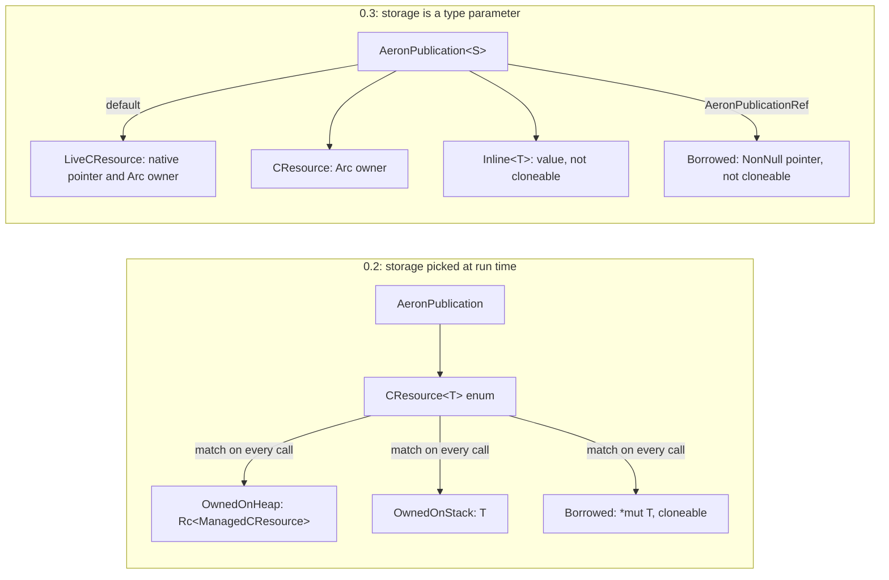
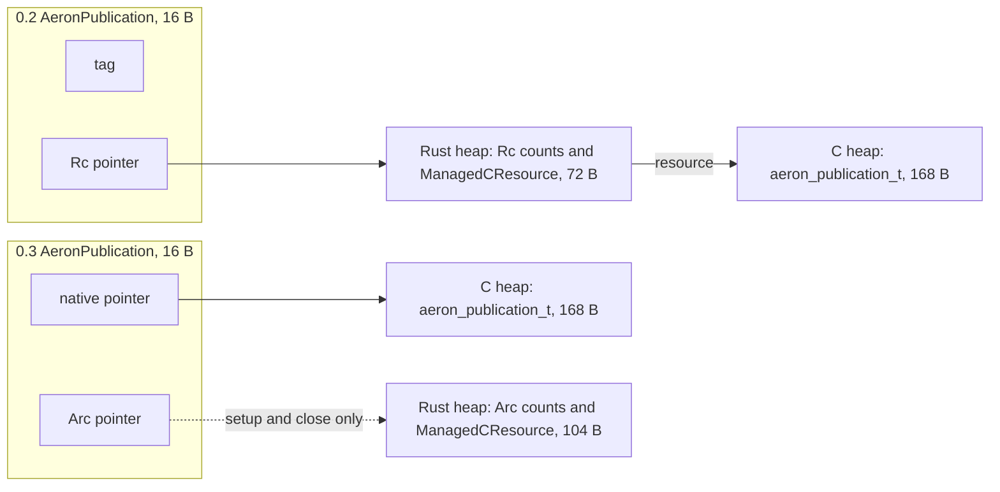

# Migrating from 0.2 to 0.3

0.3 changes resource storage, ownership and thread safety. Send and poll methods
still call the native functions directly. Most changes affect setup, callbacks,
explicit type annotations and low-level FFI access.

## Upgrade checklist

| Check existing code for | Change for 0.3 |
| --- | --- |
| `multi-threaded` dependency feature | Remove it. Thread traits are set per native type |
| `Handler::new(...)` passed to a retained conductor callback | Pass an owned callback, or use `SharedHandler::new_shared(...)` |
| Direct access through a handler's `Deref` | Use checked state access. See [accessing callback state](#accessing-callback-state) |
| Cloning a getter's `Ref` | Borrow again with `as_ref()`, or use an explicit retained-child getter |
| Function arguments annotated as the default owning wrapper | Add a storage parameter if the function should also accept borrowed views |
| Cloning an Archive context or native assembler | Keep one owner. Borrow it, or share a newly created context through `Rc` during setup |
| Cloning a subscription | Keep one owner and move it to the thread that polls it |
| `AeronArchiveReplayMerge::new(&subscription, &archive, ...)` | Pass `archive` by value. Pass `archive.clone()` if you use the archive after the merge, and leave it idle until the merge drops |
| Cloning a recording descriptor poller | Keep one mutable owner. `poll()` takes `&mut self` and needs a consumer installed by `reset()` |
| `close()` or `delete()` followed by reuse | These consume the owning handle. Use another owning clone if supported |
| `From<*mut T>`, `From<native_struct>` or implicit native struct `Deref` | Use the documented unsafe constructors or explicit field getters |
| Holding a configuration string across a setter | Use the `unsafe` getter's `&str` straight away, or call `_owned()` for a copy |
| Raw counter addresses used as references | Use `addr_atomic()` |
| `find_recording` or `collect_recordings` predicates reading `d.stream_id` | Call the getters, e.g. `d.stream_id()`. The predicate sees the borrowed descriptor, and only matches are copied into a `RecordingDescriptor` |
| `timestamp_offset_reserved("...")` | Use `media_rcv_timestamp_offset("reserved")`, `channel_rcv_timestamp_offset("reserved")` or `channel_snd_timestamp_offset("reserved")`. Aeron defines `reserved` as a value, not a key |
| Exhaustive matches on public Rust enums | Add a fallback arm. The enums are `#[non_exhaustive]` |
| Raw manual conductor calls | Call `main_do_work()` from one thread at a time, as in Aeron Java and C++ |

Update the crate versions together:

```toml
[dependencies]
rusteron-client = { version = "0.3", features = ["static"] }
```

Use `rusteron-archive` instead if you need both transport and Archive APIs.

## Borrowed strings

```rust,no_run
# use rusteron_archive::*;
# fn example() -> Result<(), AeronCError> {
let context = AeronArchiveContext::new()?;
context.set_control_response_channel(c"aeron:ipc")?;

// No allocation. SAFETY: no setter runs while `channel` is in use
let channel = unsafe { context.get_control_response_channel() };
assert_eq!(channel, "aeron:ipc");

// One explicit copy. The snapshot stays valid after the context changes.
let saved = context.get_control_response_channel_owned();
context.set_control_response_channel(c"aeron:udp?endpoint=localhost:8010")?;
assert_eq!(saved, "aeron:ipc");
# Ok(()) }
```

Text getters that a setter can change are `unsafe`. The `&str` points into native
storage with no copy. Use it straight away, or call `_owned` for a copy.

Publishing, claiming, committing, direct polling and reading recording descriptor
fields do not allocate on the Rust heap. Owned fragment assemblers allocate once
when created. Retained callbacks and parent dependencies allocate when registered.
Replication builders retain their channel strings.

`AeronCError::with_message` borrows string literals and takes ownership of a
`String`. Copy a non-static borrowed message with `.to_owned()`. `capture_errmsg()`
copies the native message once.

## Owning and borrowed handles

Generated handles have a sealed storage parameter. `Aeron` and `AeronPublication`
still mean their owning forms, so most code does not name it.

| Form | Purpose | Clone |
| --- | --- | --- |
| `Aeron`, `AeronPublication`, other supported owning handles | Own native cleanup and retain their dependencies | Where supported |
| `Ref<'a, T>` | Borrow a child or an owning handle | No |
| `AeronRef`, `AeronPublicationRef`, other `*Ref` aliases | The wrapper type inside a borrowed view | No |
| `OwnedWithReference<Owner, T>` | Retain a parent while accessing a stable child | When `Owner: Clone` |
| `Handle<Inline<Native>>` | Store an initialized native value directly | No |
| `Handle<ScopedInline<'a, Native>>` | Hold query results whose pointers borrow a parent | No |

The `CResource` enum and its variants are removed. Storage is chosen at compile
time, with no runtime tag check. Shared heap owners use `Arc`, so cloning or
dropping an owner updates a reference count.

### Storage in 0.2 and 0.3

In 0.2 every handle held a `CResource` enum. Each call matched on the variant to
find the native pointer. In 0.3 the storage is a type parameter, so the compiler
picks the variant and inlines the pointer read.



An owning publication is 16 B in both versions, but reaching the native pointer
differs. 0.2 checks the tag, follows the `Rc` and reads the pointer stored in
`ManagedCResource`. 0.3 keeps the native pointer in the handle, so it is one load.
The `Arc` owner is only used to clone, close and drop.



The table covers the most used handles. Sizes are in bytes on arm64, and the
total is the handle, plus the Rust owner block, plus the C struct. Native buffers
such as term logs are not included. A 0.2 handle is as large as its largest enum
variant, so types whose C struct bindgen can see carry that struct inline even
when they hold a heap pointer. The pointer read column counts the arm64
instructions that `get_inner()` compiles to.

In both versions Aeron C allocates the native publication, subscription, image
and counter structs, for example when an async add completes. `OwnedOnHeap` in
0.2 and `CResource` or `LiveCResource` in 0.3 name the Rust owner block that
holds that C pointer and runs cleanup. They do not mean Rust allocated the C
struct. 0.2 builds `OwnedOnHeap` for every handle that `poll()` on an async add
returns, and for `image_at_index`. Query results such as `get_constants()` and
`get_values()` were `OwnedOnStack` copies.

| 0.2 type and variant | 0.3 type | Handle | Rust heap | C struct | Total | Pointer read |
| --- | --- | ---: | ---: | ---: | ---: | --- |
| `Aeron`, `OwnedOnHeap` | `Aeron<LiveCResource<aeron_t>>` | 32 → 16 | 72 → 104 | 728 | 832 → 848 | 9 with 2 branches → 1 load |
| `AeronContext`, `OwnedOnHeap` | `AeronContext<CResource<aeron_context_t>>` | 16 → 8 | 72 → 104 | 4,520 | 4,608 → 4,632 | 9 → 2 loads |
| `AeronPublication`, `OwnedOnHeap` | `AeronPublication<LiveCResource<aeron_publication_t>>` | 16 → 16 | 72 → 104 | 168 | 256 → 288 | 9 → 1 load |
| `AeronExclusivePublication`, `OwnedOnHeap` | `AeronExclusivePublication<LiveCResource<aeron_exclusive_publication_t>>` | 16 → 16 | 72 → 104 | 320 | 408 → 440 | 9 → 1 load |
| `AeronSubscription`, `OwnedOnHeap` | `AeronSubscription<LiveCResource<aeron_subscription_t>>` | 16 → 16 | 72 → 104 | 368 | 456 → 488 | 9 → 1 load |
| `AeronImage` from `image_at_index`, `OwnedOnHeap` | `AeronImage<LiveCResource<aeron_image_t>>` | 16 → 16 | 72 → 104 | 160 | 248 → 280 | 9 → 1 load |
| `AeronCounter`, `OwnedOnHeap` | `AeronCounter<LiveCResource<aeron_counter_t>>` | 16 → 16 | 72 → 104 | 88 | 176 → 208 | 9 → 1 load |
| Callback `AeronHeader`, `Borrowed` | `AeronHeader<Borrowed<aeron_header_t>>` | 16 → 8 | none | owned by C | 16 → 8 | 9 → 1 load |
| Borrowed publication or image, `Borrowed` | `AeronPublicationRef`, `AeronImageRef` | 16 → 8 | none | owned by the parent | 16 → 8 | 9 → 1 load |
| `AeronHeaderValues` from `get_values`, `OwnedOnStack` | `AeronHeaderValues<Inline<aeron_header_values_t>>` | 48 → 44 | none | inline | 48 → 44 | 11 with 2 branches → none |
| `AeronPublicationConstants` from `get_constants`, `OwnedOnStack` | `AeronPublicationConstants<ScopedInline<'_, aeron_publication_constants_t>>` | 96 → 88 | none | inline | 96 → 88 | 9 → none |
| `AeronBufferClaim::default()`, `OwnedOnHeap` | `AeronBufferClaim<CResource<aeron_buffer_claim_t>>` | 32 → 8 | 72 → 104 | 24 | 128 → 136 | 9 → 2 loads |
| `AeronAsyncAddSubscription`, `OwnedOnHeap` | `AeronAsyncAddSubscription<CResource<aeron_async_add_subscription_t>>` | 16 → 8 | 72 → 104 | 176 | 264 → 288 | 9 → 2 loads and a null check |
| `AeronUriStringBuilder`, `OwnedOnHeap` | `AeronUriStringBuilder<CResource<aeron_uri_string_builder_t>>` | 64 → 8 | 72 → 104 | 56 | 192 → 168 | 9 → 2 loads |
| `AeronArchive`, `OwnedOnHeap` | `AeronArchive<CResource<aeron_archive_t>>` | 160 → 8 | 72 → 104 | 152 | 384 → 264 | 9 → 2 loads |
| `AeronArchiveContext`, `OwnedOnHeap` | `AeronArchiveContext<CResource<aeron_archive_context_t>>` | 4,432 → 8 | 72 → 104 | 4,424 | 8,928 → 4,536 | 9 → 2 loads |
| `AeronArchiveReplayParams`, `OwnedOnHeap` | `AeronArchiveReplayParams<CResource<aeron_archive_replay_params_t>>` | 48 → 8 | 72 → 104 | 40 | 160 → 152 | 9 → 2 loads |
| Listing `AeronArchiveRecordingDescriptor`, `Borrowed` | `AeronArchiveRecordingDescriptor<Borrowed<aeron_archive_recording_descriptor_t>>` | 136 → 8 | none | owned by C | 136 → 8 | 9 → 1 load |

What the pointer read does in each version:

| Storage | Where the native object lives | Steps to reach it |
| --- | --- | --- |
| 0.2 `OwnedOnHeap` | C heap, owned by an `Rc` block on the Rust heap | Load the tag, branch twice, load the `Rc` pointer, load the native pointer from `ManagedCResource` |
| 0.2 `Borrowed` | Owned elsewhere | Load the tag, branch twice, load the pointer |
| 0.2 `OwnedOnStack` | Inline in the handle | Load the tag, branch twice, take the address |
| 0.3 `LiveCResource` | C heap, owned by an `Arc` block on the Rust heap | Load the native pointer cached in the handle |
| 0.3 `CResource` | C heap, owned by an `Arc` block on the Rust heap | Load the `Arc` pointer, then an Acquire load of the native pointer. A plain load on x86-64 |
| 0.3 `Borrowed` | Owned elsewhere | Load the pointer |
| 0.3 `Inline`, `ScopedInline` | Inline in the handle, on the stack | Take the address. No load |

Publications, subscriptions, images, counters and the client are `LiveCResource`,
so offer, claim and poll read one pointer with no branch. The `Arc` block is 32 B
larger than the 0.2 `Rc` block because it holds atomics and mutexes for
cross-thread close and dependency changes. Those fields are only read on setup
and close. Header values and constants stay inline on the stack, with no `Arc`
or allocation.

Query results cost the same or less than in 0.2. Criterion, ns per call on Apple
M4 Max:

| Call | 0.2.10 | 0.2.22 | 0.3 |
| --- | ---: | ---: | ---: |
| publication `get_constants` | 10.68 | 8.25 | 8.04 |
| exclusive publication `get_constants` | 10.81 | 8.19 | 8.11 |
| subscription `get_constants` | 6.21 | 5.42 | 5.23 |
| image `get_constants` | 9.18 | 7.69 | 7.49 |
| poll per fragment, header `get_values` | 5.85 | 3.44 | 3.34 |
| poll per fragment, no header read | 1.62 | 1.68 | 1.59 |

A borrowed view is a bare pointer with no `Clone`, so the borrow checker stops it
from outliving its owner. A 0.2 `Borrowed` variant could be cloned into code
that outlived the native object.

### Accept any storage type

Use a generic parameter when a function needs the same methods on owning and
borrowed handles. `_` is not allowed in a named function's parameter type.

```rust
use rusteron_archive::{Aeron, ResourceStorage, bindings::aeron_t};

fn client_id<S: ResourceStorage<aeron_t>>(client: &Aeron<S>) -> i64 {
    client.client_id()
}

# fn check(client: &Aeron) {
let owning_id = client_id(client);
let borrowed = client.as_ref();
assert_eq!(owning_id, client_id(&borrowed));
# }
```

Add `S: Clone` if the function clones its handle. Borrowed and inline storage
cannot meet that bound. Constructors and cleanup methods stay on the owning type.

### Borrow a child or retain its parent

Getters such as `client.context()`, `archive.aeron()` and
`archive.get_archive_context()` return views tied to their parent. Do not turn
them into owning handles by cloning or copying native structs.

To keep a child beyond a short borrow, use a retained getter:

```rust,no_run
use rusteron_archive::*;

# fn retain(archive: AeronArchive) -> Result<(), AeronCError> {
// `None` only for an archive wrapped from a raw pointer
let client = archive.aeron_owned().ok_or_else(|| AeronCError::with_message(-1, "no client"))?;
let context = archive.retain_archive_context()?;
archive.close()?;

// The client clone and the retained context outlive the archive
let id = client.client_id();
let request_channel = context.as_ref().get_control_request_channel_owned();
# let _ = (id, request_channel);
# Ok(()) }
```

Create publications and subscriptions from the original owning client. A borrowed
client view cannot create owning children.

`AeronArchiveContext` and native fragment assemblers are not cloneable. To share a
newly created context during setup, use `Rc<AeronArchiveContext>`. Its
configuration methods still stop working after initialization.

## Close and delete

`close(self)` and `delete(self)` release that owning handle. Other owning clones
keep the allocation alive. Native cleanup runs after the last owner releases it.

Code that expected closing one clone to invalidate every other clone must now
release the other owners.

Borrowed views have no cleanup method. Unsafe forced cleanup and native removal
calls bypass these rules. Follow their safety contracts.

## Thread safety

Remove `multi-threaded` from Cargo features. It no longer exists.

| Area | 0.2 | 0.3 |
| --- | --- | --- |
| Thread traits | One `multi-threaded` feature made every handle `Send` and `Sync` | Each type follows the Aeron C contract for that object. See the table below |
| Owner reference count | `Rc`, or `Arc` with `multi-threaded` | `Arc`. Only clone and drop touch the count |
| Owner bookkeeping | `Cell` and `UnsafeCell`, or `Mutex` with `multi-threaded` | Atomics and `Mutex`, used only on create, clone, drop, close and dependency changes. Never on offer, claim or poll |
| Retained callback handler | `Handler<T>` was an `Arc<UnsafeCell<T>>`, `Send` for any `T: Send`, with no borrow check | Split in two. `Handler<T>` is local (`Rc<RefCell<T>>`). `SharedHandler<T>` is `Arc<Mutex<T>>`. Both are only for callbacks C keeps, such as error, image and close handlers. Polls never use them |
| Poll callbacks | `poll(Some(&Handler<T>), limit)`, through the `Arc` | `poll(&mut callback, limit)` or `poll_fn(closure, limit)`. A plain `&mut` goes to C. No `Rc`, `Arc`, `RefCell` or `Mutex` |
| Retained dependencies | Any value | Local owners keep local values. Shared owners keep only `Send + Sync` values |

See [callbacks and fragment assembly](#callbacks-and-fragment-assembly) for the
poll changes, [retained callbacks](client-guide.md#retained-callbacks) for when
to use `SharedHandler`, and [callback panics](callback-panics.md) for panic
handling.

**The poll path uses no `Rc`, `Arc`, `RefCell` or `Mutex`.** `poll(&mut callback, limit)`,
`poll_fn` and the owned assemblers pass a plain `&mut` to your callback to Aeron C as
`clientd`. For each fragment, the trampoline casts `clientd` back to `&mut F` and calls
it. Rusteron adds no lock, borrow check, reference count or allocation per fragment or
per poll. `Handler` (`Rc<RefCell<T>>`) and `SharedHandler` (`Arc<Mutex<T>>`) exist only for
callbacks that C keeps after the call returns, such as error, available image,
unavailable image and close handlers. The conductor calls those on events, not per
message.

This is what each hot-path call does:

| Call | Per call | Per fragment |
| --- | --- | --- |
| `subscription.poll_fn(closure, limit)` | One pointer load, then `aeron_subscription_poll` with `&mut closure` as `clientd` | The trampoline casts `clientd` back to `&mut F` and calls it. No lock, borrow check or reference count |
| `subscription.poll(&mut callback, limit)` | Same, with `&mut callback` as `clientd` | Same |
| Fragment assembler `poll` | Same, with the assembler as `clientd` | The assembler calls your closure through a plain `&mut`. No lock |
| `offer`, `try_claim`, `position` on a publication | One pointer load from `LiveCResource`, then the C call | Not applicable |
| `get_constants`, `header.get_values()` | Copy into an inline struct on the stack | No allocation or `Arc` |

`Handler<T>` and `SharedHandler<T>` hold callbacks that C keeps after the call
returns, such as error, available image, unavailable image and close handlers.
The conductor calls those on events, not per message. Poll methods do not
accept a `Handler`. The owner `Mutex` and atomics are touched only on create,
clone, drop, close and dependency changes.

What a method call does to reach the native pointer:

| Storage | Types | Per call |
| --- | --- | --- |
| `LiveCResource` | `Aeron`, publications, subscriptions, images, counters | A plain load of the pointer cached in the handle at creation. No atomic, fence or `Arc` access |
| `CResource` | Contexts, Archive handles, async operations, URI builder, default buffer claim | A plain load of the `Arc` pointer, then an Acquire load of the native pointer. That is a plain `mov` on x86-64 and one `ldapur` on arm64, with no separate fence or lock. 0.2 used a `Cell` read here, or the same Acquire load with `multi-threaded` |
| `Borrowed` | Callback `AeronHeader`, `...Ref` views, recording descriptors | A plain load |
| `Inline`, `ScopedInline` | `get_values()` and `get_constants()` results | The address of the value. No load |

One send path accepts a `Handler`. `offer_raw(buffer, Some(&handler))` and
`offerv(iov, count, Some(&handler))` take a reserved value supplier, which C
calls during the offer. Its trampoline takes `borrow_mut()` on a local `Handler`
or the mutex on a `SharedHandler` each time. `offer(buffer)`, `try_claim` and
`offer_raw(buffer, None)` pass no supplier and touch no handler. For a reserved
value on the hot path, use `offerv_fn(iov, count, closure)`, which passes the
closure as a plain `&mut` like `poll_fn`.

Default owning handle types:

| Handle | Send | Sync |
| --- | --- | --- |
| `Aeron`, `AeronPublication`, `AeronCounter`, `AeronCountersReader` | Yes | Yes |
| `AeronSubscription` | Yes | No |
| `AeronExclusivePublication`, `AeronImage` | No | No |
| Contexts, async registrations, native assemblers, Archive and driver handles | No | No |
| Local `Handler<T>` | No | No |
| `SharedHandler<T>` with `T: Send` | Yes | Yes |

Create local resources on the thread that uses them. A regular publication can be
shared among producer threads. Borrowed and retained views follow the thread
traits of their storage and parent.

Subscriptions have no `Clone`, so a subscription can move to the thread that
polls it. A retained image from
`image_at_index` stays local. The grouped `No` entries are conservative. See
[thread safety](thread-safety.md#native-contracts-and-wrapper-traits).

Configure contexts before native initialization. Later setters return an error,
or panic if the signature has no error result. Manual conductor methods such as
`main_do_work()` and `main_idle_strategy()` are safe. As in Aeron Java and C++,
call them from one thread at a time. A background conductor avoids this for
shared clients.

To share a client or regular publication, put it in an `Arc` or clone it. See
[sharing across threads](client-guide.md#sharing-across-threads) for an example
and [thread safety](thread-safety.md) for the audited types.

## Callbacks and fragment assembly

Fragment assembly has three forms:

- `FragmentAssembler` and `ControlledFragmentAssembler` own a fixed callback.
  They replace the native `Aeron*FragmentAssembler` wrappers,
  `FnMutMessageHandler`, `FnMutControlledMessageHandler` and
  `Handler::with_*_fragment_assembler`. Read callback state with `handler()` or
  `handler_mut()`.
- `AeronImageFragmentAssembler` and `AeronImageControlledFragmentAssembler` keep
  their names. `new` takes the callback by value instead of a `Handler`, and
  `poll(&image, limit)` polls with it. They poll one image with one buffer
  allocated at creation.
- `AeronFragmentClosureAssembler` and `AeronControlledFragmentClosureAssembler`
  keep their names but take a closure on each poll:
  `poll(&subscription, closure, limit)`. The closure can borrow local state, so
  the `ctx` argument and `fn` pointer are gone.

Poll a subscription with `assembler.poll(&subscription, ...)` and an image with
`image_assembler.poll(&image, ...)`. For any other poll target, pass the
assembler itself, or `&mut assembler.with(closure)` for the closure forms.

A persistent subscription reassembles messages itself. If 0.2 code polled one
through a closure assembler, use `ps.poll_fn(closure, limit)`, or
`ps.controlled_poll_fn(closure, limit)` for the controlled form. Passing an
assembler to `ps.poll` or `ps.controlled_poll` still works but adds a call per
message.

Choose callback storage by how C invokes it:

| Callback | API |
| --- | --- |
| Reusable fragment callback | `subscription.poll(&mut callback, limit)` |
| Synchronous closure | `subscription.poll_fn(closure, limit)` |
| Retained callback that may run on a conductor | Owned setter, or `SharedHandler::new_shared(callback)` |
| Fixed complete-message callback | `FragmentAssembler::new(callback)` |
| New complete-message closure per poll | `AeronFragmentClosureAssembler::new()` with `poll(&subscription, closure, limit)` |
| Controlled complete-message callback | `ControlledFragmentAssembler::new(callback)` or `AeronControlledFragmentClosureAssembler::new()` |

An owned setter picks the shared callback storage for you:

```rust,no_run
use rusteron_archive::*;

# fn configure(context: &AeronContext) -> Result<(), AeronCError> {
context.set_error_handler(Some(|code: i32, message: &str| {
    eprintln!("Aeron {code}: {message}");
}))?;
# Ok(()) }
```

`poll`, `controlled_poll`, bounded polls and block polls take `&mut callback`.
They allocate nothing and do no borrow check or mutex lock. `Handler` does not
implement the fragment callback traits, and no poll takes one. Replace 0.2's
`poll(Some(&handler), limit)` by owning the callback and calling
`poll(&mut callback, limit)`. Keep poll state in the callback itself, or in an
owned assembler, and read it between polls.

### Reusable fragment callbacks

In 0.2, a reusable callback uses `Handler`, and the callback receives its header
by value:

```rust,ignore
use rusteron_archive::*;

#[derive(Default)]
struct Receiver(usize);

impl AeronFragmentHandlerCallback for Receiver {
    fn handle_aeron_fragment_handler(&mut self, bytes: &[u8], _header: AeronHeader) {
        self.0 += bytes.len();
    }
}

# fn receive(subscription: &AeronSubscription) -> Result<(), AeronCError> {
let callback = Handler::new(Receiver::default());
subscription.poll(Some(&callback), 32)?;
# Ok(()) }
```

In 0.3, keep the callback on the stack and pass a mutable borrow. The header is
borrowed too:

```rust,no_run
use rusteron_archive::*;

#[derive(Default)]
struct Receiver(usize);

impl AeronFragmentHandlerCallback for Receiver {
    fn handle_aeron_fragment_handler(&mut self, bytes: &[u8], _header: &AeronHeader) {
        self.0 += bytes.len();
    }
}

# fn receive(subscription: &AeronSubscription) -> Result<(), AeronCError> {
let mut callback = Receiver::default();
subscription.poll(&mut callback, 32)?;
# Ok(()) }
```

The callback can be reused between polls. It needs no reference count, `RefCell`
or mutex. `poll_fn` keeps the same call syntax.

### Fragment assembly

In 0.2, `Handler::with_fragment_assembler` returns two reference-counted handlers,
the assembler to poll with and the inner callback to read state from.

```rust,ignore
use rusteron_archive::*;

#[derive(Default)]
struct Messages(usize);

impl AeronFragmentHandlerCallback for Messages {
    fn handle_aeron_fragment_handler(&mut self, _message: &[u8], _header: AeronHeader) {
        self.0 += 1;
    }
}

# fn receive(subscription: &AeronSubscription) -> Result<(), AeronCError> {
let (assembler, messages) = Handler::with_fragment_assembler(Messages::default())?;
subscription.poll(Some(&assembler), 64)?;
println!("{} complete messages", messages.0);
# Ok(()) }
```

In 0.3, `FragmentAssembler` owns the callback. Poll through the assembler, or pass
`&mut assembler` to any poll method, and read state with `handler()`:

```rust,no_run
use rusteron_archive::*;

#[derive(Default)]
struct Messages(usize);

impl AeronFragmentHandlerCallback for Messages {
    fn handle_aeron_fragment_handler(&mut self, _message: &[u8], _header: &AeronHeader) {
        self.0 += 1;
    }
}

# fn receive(subscription: &AeronSubscription, image: &AeronImage) -> Result<(), AeronCError> {
let mut assembler = FragmentAssembler::new(Messages::default())?;
assembler.poll(subscription, 64)?;
image.poll(&mut assembler, 64)?;
println!("{} complete messages", assembler.handler().0);
# Ok(()) }
```

The controlled form changes the same way. `Handler::with_controlled_fragment_assembler`
becomes `ControlledFragmentAssembler::new`, and the callback returns an action:

```rust,no_run
use rusteron_archive::*;

struct UntilFull(Vec<u8>);

impl AeronControlledFragmentHandlerCallback for UntilFull {
    fn handle_aeron_controlled_fragment_handler(
        &mut self,
        message: &[u8],
        _header: &AeronHeader,
    ) -> bindings::aeron_controlled_fragment_handler_action_t {
        if self.0.len() + message.len() > self.0.capacity() {
            // Leave the message in the log and stop this poll
            return bindings::aeron_controlled_fragment_handler_action_t::AERON_ACTION_ABORT;
        }
        self.0.extend_from_slice(message);
        bindings::aeron_controlled_fragment_handler_action_t::AERON_ACTION_CONTINUE
    }
}

# fn receive(subscription: &AeronSubscription) -> Result<(), AeronCError> {
let mut assembler = ControlledFragmentAssembler::new(UntilFull(Vec::with_capacity(1 << 20)))?;
assembler.poll(subscription, 64)?;
assembler.handler_mut().0.clear();
# Ok(()) }
```

An assembler is not `Clone`, so one owner polls it. Dropping it frees the native
assembler and any partial messages.

### Accessing callback state

Handlers no longer dereference to callback state.

- Local `Handler::lock()` returns a mutable `RefCell` guard and `borrow()` a read
  guard. Both check borrowing on the current thread, with no mutex or atomic
  operation. Use them for retained callbacks only, never for poll state.
- `SharedHandler::lock()` takes a mutex. A retained shared callback takes the same
  mutex when invoked, so contention can delay either side. Keep guards short.
- `poll(&mut callback, limit)`, `poll_fn` and the owned assemblers use plain Rust
  borrowing with no guards. Use them when one polling thread owns the callback.

Release a state guard before invoking the same handler through C. A local handler
rejects the second borrow and a shared handler deadlocks on its own mutex. See
[synchronization costs](thread-safety.md#hot-path-behaviour).

For a simple polling loop, a closure assembler avoids shared callback storage.
The closure borrows local variables for the poll call only:

```rust,no_run
use rusteron_archive::*;

# fn receive(subscription: &AeronSubscription) -> Result<(), AeronCError> {
let mut bytes = 0;
let mut assembler = AeronFragmentClosureAssembler::new()?;
assembler.poll(subscription, |message, _header| bytes += message.len(), 64)?;
println!("received {bytes} bytes");
# Ok(()) }
```

With a fixed-callback `FragmentAssembler`, `handler()` and `handler_mut()` expose
the callback between polls.

Callback wrapper types now reflect borrowing. Image callbacks and `for_each_image`
use `&AeronImageRef`, and headers use `&AeronHeader`. Update explicit callback
signatures and copy any fields you need after the callback returns.

Registered handlers stay alive until native cleanup. Archive connections keep the
callback registrations copied when the connection starts. Use
`AeronErrorHandlerSlot` when a replacement should affect existing connections.
See [callback ownership](archive-guide.md#why-replaced-handlers-stay-alive) and
[panic behaviour](callback-panics.md).

## Buffer claims and query results

Prefer `try_claim_owned()` for publishing:

```rust,no_run
use rusteron_archive::*;

# fn send(publication: &AeronPublication) -> Result<(), Box<dyn std::error::Error>> {
let mut claim = publication.try_claim_owned(5)?;
claim.data().copy_from_slice(b"hello");
claim.commit()?;
# Ok(()) }
```

The claim, copy and commit sequence is unchanged. If a helper returns a claim, add
the publication's lifetime to its return type.

0.2:

```rust,ignore
use rusteron_archive::*;

fn claim(publication: &AeronExclusivePublication) -> Result<AeronClaim, AeronOfferError> {
    publication.try_claim_owned(32)
}
```

0.3:

```rust
use rusteron_archive::*;

fn claim(publication: &AeronExclusivePublication) -> Result<AeronClaim<'_>, AeronOfferError> {
    publication.try_claim_owned(32)
}
```

`AeronClaim<'a>` borrows the publication, is not cloneable, and aborts if dropped
unfinished. `data()` needs mutable access, so mutable slices cannot overlap. The
lifetime adds no runtime cost.

The low-level `AeronBufferClaim` API needs `unsafe` to construct claims from
external buffers. `data()`, `commit()` and `abort()` are safe. As in Aeron Java
and C++, the bytes stay valid only until the claim is committed or aborted. The same applies to
pointer-bearing wrappers such as `AeronMappedBuffer`. An unsafe constructor does
not extend the backing buffer's lifetime.

Use `get_constants()` and `get_buffers()` to get initialized query results.
Pointer-bearing results carry the queried handle's lifetime, so keep that handle
alive. Raw output-parameter variants such as `get_buffers_into()` need `unsafe`
when their output borrows native memory. Pointer-free header snapshots are
independent values.

`addr()` on a counter returns a raw pointer. Use `addr_atomic()` with an explicit
atomic ordering for safe concurrent access.

## Archive ownership and strings

Params built with `AeronArchiveReplicationParams::builder()` retain their strings
and credentials, including after you clone the params and drop the builder's
owner. `build()` returns an error for embedded NULs in string fields.

- `set_aeron(&client)` retains the Rust-owned client. Safe code cannot transfer
  that client's ownership to native context cleanup. `set_owns_aeron_client(true)`
  returns an error.
- Borrowed Archive contexts cannot be reconfigured or start a connection.
  Configure an owning context first.
- Set a Rust-owned client with `context.set_aeron(&client)` before starting an
  archive connection. `AeronArchiveAsyncConnect::new()` rejects a context without
  one. `new_with_aeron()` also checks that the context uses the supplied client.
- Complete registrations through their async handle's `poll()` or
  `poll_blocking()`. Constructors such as `AeronPublication::new(&pending)` are
  internal. Calling the native poll alone skips dependency transfer. Completed or
  cancelled async handles cannot expose a cached borrowed view.
- Deleting a separately created `AeronArchiveProxy` leaves its Rust-owned
  publication open. It closes when its last owner is released.
- Text getters return borrowed `&str` without allocating. Replaceable text, such
  as `get_control_request_channel()` or `errmsg()`, is `unsafe`. Use it before any
  setter, poll or close changes it, or call the `_owned` getter for a copy.
- Optional persistent-subscription counter getters return
  `Option<Ref<'_, AeronCounter>>`. Handle `None` for an unset counter. Raw setters
  and builder counter methods that transfer native ownership need `unsafe` and
  exclusive ownership.

Persistent subscriptions retain their context, client, archive context and
listener. Set a Rust-owned client on the persistent-subscription context or its
archive context before `create()`. Both contexts must use the same client. Context
aliases stay valid after the subscription closes, but a used subscription context
cannot be reconfigured or used to create another subscription.

The archive context cannot be reconfigured while a persistent subscription uses
it, because native reconnects read it and copy its callbacks. It can be
reconfigured after the subscription is cleaned up. Use separate archive contexts
for independently configured subscriptions.

Every assembler has one mutable owner, frees its native assembler on drop, cannot
be cloned and does not expose the native pointer.

## System counter IDs

`AeronSystemCounterType` uses the constants in the native bindings. The `DummyLast`
variant is removed. Aeron defines counters at IDs 40 through 45, including
`PublicationsRevoked` and `NativeResourceAgentProxyFails`. Use
`AeronSystemCounterType::try_from(id)` to check an ID instead of a sentinel value.

`AeronCounterTypeId` represents built-in counter types, such as `PublisherLimit`
and `ArchiveRecordingPosition`. It is not a counter's allocated ID.
`AeronCounterState` represents `Unused`, `Allocated` and `Reclaimed`.
`reader.counter_type(id)` and `reader.counter_record_state(id)` return these enums.
`foreach_typed_counter_fn`, `find_by_counter_type` and
`find_by_counter_type_and_registration_id` take or pass `AeronCounterTypeId`.
`reader.system_counter_value(AeronSystemCounterType::BytesSent)` reads a driver
system counter. Both enums keep unknown integers and return the raw value through
`code()`. The integer methods still work.

## Native enum conversions

The generator adds Rust names for native enums and their values. The C names still
work. For example:

```rust
use rusteron_archive::AeronControlledFragmentHandlerAction as Action;

let action = Action::Continue;
assert_eq!(u32::from(action), 4);
assert_eq!(Action::try_from(99_u32), Err(99));
```

Controlled-poll callbacks can return `Action::Continue` or `Action::Abort`
directly. The Media Driver accepts `AeronThreadingMode::Shared`, and Archive
methods accept `AeronArchiveSourceLocation::Local`. These use the native enum
representation, so passing them needs no conversion or allocation.

Native enums have generated `TryFrom` and `From` implementations. Use them instead
of copying numeric values into a match or using `transmute`. Unknown integers
return `Err(value)`.

```rust
use rusteron_archive::bindings::aeron_controlled_fragment_handler_action_t;

let action = aeron_controlled_fragment_handler_action_t::try_from(4_u32).unwrap();
assert_eq!(u32::from(action), 4);
assert_eq!(aeron_controlled_fragment_handler_action_t::try_from(99_u32), Err(99));
```

The implementation uses the enum's native integer type. Controlled-poll actions
use `u32`, and Archive recording signals use `i32`. The recording-signal helper
still returns `None` for null and unknown codes. Direct enum conversion accepts
the native null variant.

## Replay parameters and Archive protocol versions

The Archive bindings include `aeron_archive_replay_params.h` and
`aeron_archive_configuration.h`.

- `params.is_bounded()` checks whether a replay has a bounding counter.
- `destination.copy_from(&source)` copies every replay parameter into existing
  storage. The source can use owning or borrowed storage and is left unchanged.
- `AeronArchive::semantic_version()` returns the Archive protocol version.
- `AeronArchive::protocol_version_with_archive_id()` returns the first protocol
  version that supports Archive IDs.

Use `Aeron::semantic_version_major`, `semantic_version_minor` and
`semantic_version_patch` to read the version components.

## Native comparisons with two handles

When a native function took two pointers of the receiver's type, the generator
used `self` for both. The second pointer is now a separate argument. This fixes
Media Driver channel-tag matching, IPv4 and IPv6 prefix comparisons, and
socket-address comparisons. Pass the second handle at each affected call site. For
example, `first.aeron_ipv4_does_prefix_match(&second, 24)` compares two IPv4
addresses and returns `Result<bool, AeronCError>`. IPv4 prefix utilities return
`Err` for lengths above 32. IPv6 comparisons return `Err` for lengths above 128.

## Archive credentials

`AeronArchiveCredentialsSupplier::encoded_credentials()` and `on_challenge()`
return `Option<Ref<'_, AeronArchiveEncodedCredentials>>`. `None` means no
callback is installed or the callback returned no credentials.

## Archive error codes

Archive control requests read the native error code instead of parsing the
message. `poll_for_error()` also returns a typed code from the response poller,
with the full message. An error with an empty message still returns `Some(error)`.

Use `AeronArchiveErrorCode::from_native_code(code)` for error-handler codes or
`aeron_errcode()`. Known Archive codes accept either sign. Other native codes keep
their value and sign in `Unknown(code)`. `AeronArchiveError::parse` is removed.

Converting `AeronArchiveError` to `AeronCError` keeps the native code instead of
using `-1`. Match on the typed Archive code rather than assuming every failed
control request has the same numeric code.

`AeronDriverErrorCode` covers the separate driver protocol codes. Its `from_code()`
and `code()` methods keep the wire value and its sign. Do not pass publication
offer results or system errors to this enum, because the same number means
something different in those APIs.

## Raw pointers and native structs

Safe `From<*mut T>`, `From<*const T>` and native-struct conversions are removed.
`unsafe from_ptr()` produces a borrowed handle and needs a valid, non-null pointer
for every use. `unsafe from_native()` stores a native value inline without
validating the memory its pointers reach.

Low-level native initializers that accept external storage need `unsafe`. Their
retained pointers must stay valid until cleanup, and initialization must not
overwrite live native state. Use the owning constructors where available.

Native structs no longer appear through an implicit `Deref`. Use the wrapper's
field methods. `get_inner_ref()` and `get_inner_mut()` need `unsafe` and
coordination with every Rust and native alias. `get_inner()` returns a raw pointer.
It does not transfer ownership or make dereferencing safe.

Zeroed native-handle constructors need `unsafe`, because zeroed memory is not an
initialized connection. `Aeron`, `AeronPublication`, `AeronExclusivePublication`,
`AeronSubscription`, `AeronCounter` and `AeronCountersReader` have none. `Default`
exists only where zeroed memory is a valid value, such as `AeronBufferClaim` and
`AeronUriParam`. Prefer typed constructors and safe query methods.

`unsafe clone_reference()` on `AeronHeader` and `AeronPublicationErrorValues` is
removed. Owned values implement `Clone`. Callback arguments are borrowed, so they
cannot be cloned or outlive the callback. Copy out the fields you need.

The archive pollers no longer expose `fragment_assembler()`. Their `poll()` still
reassembles responses, so nothing replaces it.

`clone_struct()` makes a shallow copy and needs `unsafe` when pointer fields could
keep borrowing the original memory, including pointers inside unions, arrays and
nested structs. It does not create an independent native resource or duplicate
cleanup rights. Prefer copying individual fields into Rust values. Copies of
structs that contain only plain values stay safe.

`Debug` shows safe fields and immutable queries, including a runner's `role_name`
and `running` flag and publication constants. On a handle that cannot leave its
thread, it also shows replaceable text. Shared handles and opaque callback headers
need explicit queries.

Generated methods and constructors that accept raw pointers need `unsafe`,
including their closure variants. Internal resource constructors are private.
Native readers that cannot accept a null callback reject `None` before entering C.
Publication reserved-value suppliers stay optional. Invalid UTF-8 in
length-delimited text callbacks produces an empty string, as with C-string
callbacks. Message buffers stay byte slices.

Archive's generated `get_and_own_archive_context()` and
`get_and_own_control_response_subscription()` are removed. C transfers cleanup
responsibility, which a borrowed return value cannot represent. Use the borrowed
getters or `retain_archive_context()`. Raw ownership transfers remain available
through the unsafe C bindings.

`AeronArchivePersistentSubscription::get_and_own_persistent_subscription_context()`
is removed. `build()` already moves the context into Rust ownership and closes it
when the last handle drops, so closing the pointer yourself would free it twice.
Use `get_persistent_subscription_context()` to borrow it.

Recording descriptor pollers and recording subscription descriptor pollers no
longer implement `Clone`. Their `poll()` methods take `&mut self`, and borrowed
Archive poller views cannot be polled. For asynchronous listing, create an owned
poller and call `reset()` with a non-null consumer before polling. Archive's
blocking listing methods still accept borrowed closures.

`Inline<T>` stores an initialized native value and does not implement `Clone`.
`PinnedInline<T>` needs `Pin<&Self>` to get its raw pointer and does not implement
`ResourceStorage`. Pinning does not manage the native lifetime or cleanup. Callers
using raw FFI are responsible for both.

## Enums and durations

Public Rust status, error and configuration enums are `#[non_exhaustive]` where
variants may be added. Include a fallback arm when matching outside the crate. Raw
C bindings keep their native representation.

Use the checked `Duration` helpers where available, including
`AeronContext::set_driver_timeout`, the resource-linger and idle-sleep helpers,
`AeronArchiveContext::set_message_timeout`, and the URI `*_duration` setters. Raw
methods keep unit suffixes such as `_ns` or `_ms`.

## Performance compared with 0.2

Every version below used Aeron 1.54.2 and Rust 1.98.1. Lower is better.

### Apple M4 Max (arm64)

Instructions per call, counted in the compiled wrapper:

| Call | 0.2.10 | 0.2.22 | 0.3 |
| --- | ---: | ---: | ---: |
| `offer` | 31 | 30 | 21 |
| exclusive `offer` | 31 | 30 | 21 |
| `try_claim`, copy, `commit` | 216 | 58 | 40 |
| `poll_fn` | 31 | 31 | 24 |
| poll with a reusable callback | 29 | 29 | 21 |
| `image.poll` | 29 | 29 | 21 |
| `position()` | 9 | 9 | 2 |

Criterion `offer_claim_poll` bench, ns per call over IPC. C rows call the native
function directly. 0.2.10 copies the header for each fragment, which is why its
header reads cost more.

| Workload | 0.2.10 | 0.2.22 | 0.3 |
| --- | ---: | ---: | ---: |
| C `offer` 32 B | 5.92 | 5.87 | 5.88 |
| `offer` 32 B | 6.35 | 6.13 | 6.02 |
| C claim, copy, commit 32 B | 6.11 | 6.19 | 6.15 |
| claim, copy, commit 32 B | 8.96 | 7.00 | 5.43 |
| claim, copy, commit 256 B | 13.23 | 11.54 | 9.21 |
| claim, commit 256 B | 33.24 | 27.72 | 22.76 |
| `offer` 1 KiB | 22.68 | 22.95 | 21.90 |
| C poll, per fragment | 1.59 | 1.59 | 1.59 |
| `poll_fn`, per fragment | 1.58 | 1.58 | 1.58 |
| `poll_fn` with 4 header reads | 15.12 | 2.20 | 2.21 |
| reusable callback, per fragment | 1.59 | 1.59 | 1.58 |
| empty poll | 4.50 | 4.57 | 4.59 |
| fragment assembler, per message | 2.36 | 2.49 | 2.36 |
| publication `get_constants` | 10.09 | 8.08 | 7.97 |

### Intel Xeon Platinum 8375C (x86-64)

EC2 m6i.xlarge, a shared VM. The table shows p50 / p99 in ns. Per-call rows are
averages of 1,000-call batches, and each poll call reads 10 messages. Each
workload ran 10 to 20 times for 30 s, rotating the version order. Most
differences are within the spread between runs.

| Workload | 0.2.10 | 0.2.22 | 0.3 |
| --- | --- | --- | --- |
| `offer` 32 B | 41.0 / 88.3 | 40.8 / 89.2 | 43.4 / 92.7 |
| `offer` 1 KiB | 131 / 216 | 132 / 218 | 131 / 216 |
| exclusive `offer` 32 B | 17.6 / 40.9 | 18.0 / 42.2 | 16.7 / 40.2 |
| claim, copy, commit 32 B | 44.6 / 87.3 | 41.1 / 90.1 | 40.5 / 81.9 |
| claim, copy, commit 256 B | 60.3 / 106 | 60.3 / 107 | 57.3 / 104 |
| claim, commit 32 B | 38.6 / 91.8 | 37.4 / 85.3 | 35.8 / 78.7 |
| C `offer` 32 B | 39.0 / 84.6 | 42.5 / 92.7 | 39.3 / 82.4 |
| `poll_fn` | 73.7 / 186 | 75.9 / 190 | 74.4 / 195 |
| reusable callback | 75.8 / 188 | 73.0 / 181 | 79.6 / 187 |
| `image.poll` | 76.9 / 182 | 77.7 / 181 | 75.1 / 183 |
| fragment assembler 32 B | 97.8 / 254 | 96.3 / 248 | 94.7 / 226 |
| empty poll | 12.1 / 38.6 | 12.1 / 38.8 | 11.0 / 36.2 |
| `position()` | 1.74 / 3.49 | 1.45 / 3.49 | 2.08 / 2.40 |
| IPC round trip 32 B | 325 / 410 | 323 / 414 | 322 / 408 |
| UDP localhost round trip 32 B | 10,919 / 24,319 | 10,935 / 24,559 | 10,935 / 24,303 |

IPC throughput, million messages per second, median of the runs:

| Payload | 0.2.10 | 0.2.22 | 0.3 |
| --- | ---: | ---: | ---: |
| 32 B | 21.7 | 21.2 | 21.9 |
| 256 B | 16.0 | 15.7 | 15.8 |
